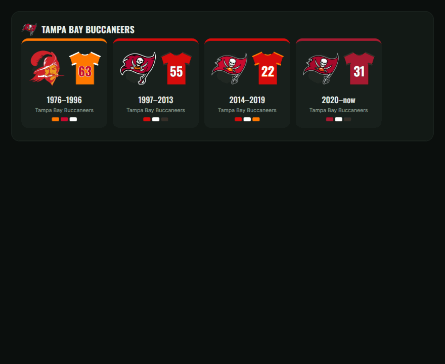
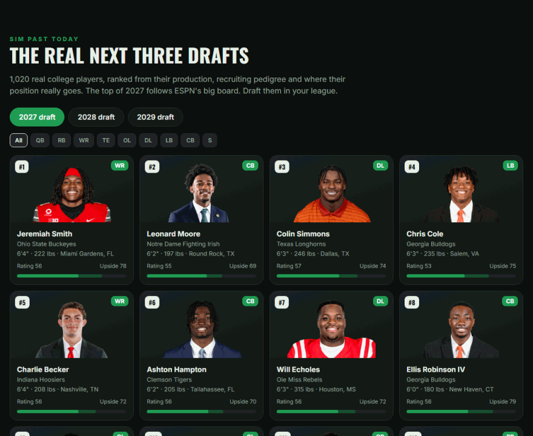

<p align="center"></p>

<p align="center">
  
  
  
  
  
</p>

<h2 align="center"><a href="https://jenzimibruh.github.io/nfl-history-fbgm/">🌐 Open the NFL History site →</a></h2>
<p align="center"><a href="docs/roadmap.md"><b>📅 Roadmap & update calendar</b></a>: the file updates the day after every game</p>
<p align="center"><a href="CHANGELOG.md"><b>🆕 What's new</b></a>: v1.4: draft classes restored, mod installer fixed; v1.3: pass rushers and nose tackles; v1.1: ratings fixes from your reports, phones, start at any week</p>
<p align="center"><sub>Every team's logos, jerseys, records and ratings · the real draft classes · build a league for any season, right in your browser</sub></p>

<table align="center"><tr>
<td align="center" width="33%"><a href="#-play-today"><b>⚡ Play today</b></a><br><sub>This season through Sunday's games.<br>Stock Football GM, phone or computer.</sub></td>
<td align="center" width="33%"><a href="#-pick-any-season"><b>📅 Pick any season</b></a><br><sub>1967 to 2027, preseason to draft day.<br>One HTML file, works offline.</sub></td>
<td align="center" width="33%"><a href="#-full-experience-the-mod"><b>🏈 Full experience</b></a><br><sub>Real schedules, drafts and careers.<br>One-click install.</sub></td>
</tr></table>

---

## Why this exists

I've played Football GM since 2020. Basketball GM is what got me into NBA history and stats, and BBGM has everything: real players, real ratings, portraits, team logos and jersey history going back decades. You can start in 1985 and see if you'd have drafted Jordan.

Football GM didn't have any of that, so I built it.

— <b>JenZiMiBruh</b>

This is every NFL season from 1966 to today, with real players, ratings built from what they actually did, real schedules, logos and jerseys by era, and the things that really happened: expansion, relocations, rule changes, retirements, comebacks and suspensions.

## How to play

Three ways in. Pick the one that sounds like you; every step is below with exactly what you'll see. (Also as a page: [`site/guide.html`](site/guide.html).)

| | ⚡ Play today | 📅 Pick any season | 🏈 Full experience |
|---|---|---|---|
| **You get** | This season as of Sunday | Any season, 1967 to today | History that keeps happening |
| **Phone** | ✅ | ✅ | ✅ over Wi-Fi |
| **Install anything?** | No | No | One double-click |
| **Time** | 2 minutes | 5 minutes | 10 minutes, once |

---

### ⚡ Play today


The real 2026 season as of Sunday, Nov 1: standings, stats, rosters and injuries, with all of NFL history since 1966 behind it. Regular Football GM, nothing to install.

1. **Download** [`NFL_2027_Live_FBGM.json.gz`](../../releases/latest/download/NFL_2027_Live_FBGM.json.gz) from the latest release. Don't unzip it. On an older or low-memory phone, get [`NFL_2027_Live_Lite_FBGM.json.gz`](../../releases/latest/download/NFL_2027_Live_Lite_FBGM.json.gz) instead: the same season at 13 MB, without long-retired role players.
2. **Open** [play.football-gm.com](https://play.football-gm.com) and tap **New League**.
3. In the **Customize** box, change **Default** to **Upload league file** and choose the file.
4. **Pick your team** and tap **Create league**.

<p align="center"></p>

---

### 📅 Pick any season


Start in 1985, 2007, any season from 1967 on, at any of five start points, just like Basketball GM: **preseason**, **week 1**, **the playoffs** (real regular season already played), **after the playoffs** (real champion and awards) or **draft day** (real draft order). The season selector is one page that runs in your browser, even offline.

1. **Open** [**Build a league** on the NFL History site](https://jenzimibruh.github.io/nfl-history-fbgm/#build) and tap **Load NFL history**. (Offline instead? Download [`nfl_season_selector.html` and `NFL_Master_1966_2026.json.gz`](../../releases/latest), open the selector and drop the master file on it.)
2. Wait a moment while 60 years of history load in your browser.
3. **Pick** a season, a start point (Preseason, Week 1, Playoffs, After Playoffs or Draft) and the real events you want, then **Generate & download**.
4. **Upload** your new file in Football GM, same as Play today, steps 2–4.

<p align="center"></p>

---

### 🏈 Full experience (the mod)


Everything above, plus history that keeps happening: the real schedule every season, real drafts, careers that follow the real one, real retirements and comebacks, and settings for all of it.

1. **Download** [`NFL_History_Mod.zip`](../../releases/latest) and unzip it.
2. **Double-click** `Install_and_Play.bat` (Mac or Linux: `install_and_play.sh`). The first run sets everything up in 5–10 minutes.
3. The game opens in your browser: **New League → Upload league file**, and the **NFL History** box lets you pick any season.
4. **On your phone**, open the address the window shows, on the same Wi-Fi.

<p align="center"></p>

> 🤖 **There's an Android app, too.** A native Android version exists: Football GM's engine inside a real app, no browser. Football GM's license doesn't allow distributing builds, so it can't be released, but I'd love to put it out someday.

Seasons are named the way Basketball GM names them, by the year they end: 2008 is the 2007 season.

## Things to try

| | |
|---|---|
| 🏆 **Go 19-0** | Start in 2007 with the Patriots. Same roster, same schedule. Finish what they couldn't. |
| 🦁 **Keep Barry Sanders** | Start in 1999 and talk him out of retiring. How many yards does he end with? |
| 🐻 **Run it back with the '85 Bears** | Can Ditka's defense win more than one ring? |
| 🏈 **Draft Arch Manning** | Start today and sim to April. The real 2027 class is waiting. |
| 🔁 **Rewrite a relocation** | Keep the Oilers in Houston, the Rams in L.A., the Colts in Baltimore, then see who becomes a dynasty. |
| 📈 **Turn history off** | Set Real Player Determinism to 0 and watch 60 years of football go sideways. |

## Your team's history

Every franchise gets its own page on the **[NFL History site](https://jenzimibruh.github.io/nfl-history-fbgm/)**, an interactive site with every logo and jersey a team wore, every season's record, and every notable player with his rating season by season. Open it at [jenzimibruh.github.io/nfl-history-fbgm](https://jenzimibruh.github.io/nfl-history-fbgm/), or double-click [`site/index.html`](site/) in a downloaded copy. Everything below is real footage of it.

<p align="center"></p>

### Every logo and jersey, switching on the real date

146 looks across 32 franchises, built right into the league file, and all of today's uniforms checked against the real 2026 ones. Start in 1976 and the Bucs are creamsicle orange; sim to 1997 and they switch on the real date. The Oilers become the Titans, the Rams go to St. Louis and back, and the Titans unveil the Shield in 2026.

<p align="center"></p>

<details><summary><b>The Rams: 14 looks</b></summary>

<p align="center"></p>

</details>

### Every season, every rating

<p align="center"></p>

Pick any season and see who mattered, rated from what they really did. 2007 Patriots:

<p align="center"></p>

<table><tr>
<td width="55%"></td>
<td width="45%"></td>
</tr></table>

## The real next three drafts

Sim past today and you're not drafting made-up players. The 2027, 2028 and 2029 classes are **1,020 real college players** with their real schools, hometowns and headshots, ranked from college production, recruiting pedigree and where their position really goes. The top of 2027 follows ESPN's big board ([how](docs/draft-classes.md)).

<p align="center"></p>

## What's in the league

| | |
|---|---|
| 🧑‍🤝‍🧑 **28,700+ real players** | Season stats from 1966 on: passing, rushing, receiving, defense, kicking by distance, punting, returns, playoffs |
| 📊 **Every team season** | Real records, points, team and opponent totals, playoff brackets 1966–2026 |
| ⭐ **Ratings for everyone** | Built from real production, including the players with almost no stats ([how](docs/ratings.md)) |
| 🏆 **Awards & honors** | MVP, OPOY/DPOY, rookies, Super Bowl MVP, All-Pro, Pro Bowl, Hall of Fame with induction years, retired numbers |
| 🎨 **Logos & jerseys by era** | 146 looks in high resolution, built into the file, with today's uniforms matched to the real 2026 ones |
| 🗓️ **Real schedules** | Every game since 1966, in order |
| 📰 **121 real-life events** | Each with the reason: Sanders and Luck retiring, Brady's 40 days, Favre's returns, Vick's prison term, Deflategate |
| 🔴 **Live 2027** | Standings, stats, rosters, injured reserve and injuries through Sunday, Nov 1 (Week 8) |
| 📸 **Player photos** | Real headshots for 4,000+ players and every draft prospect |
| 🎓 **Real draft classes 2027–2029** | 1,020 real college players ([how](docs/draft-classes.md)) |

## The mod: settings for everything

The league file works anywhere, but stock Football GM forgets history the moment you sim: it makes up schedules, drafts fictional rookies, and players develop at random. The mod fixes that, and every piece is a setting you can turn off.

| | |
|---|---|
| 📈 **RPD** | Real Player Determinism: careers follow the real one, one slider from random to exactly real |
| 🗓️ **Real schedules** | Every real game, in order, since 1966 |
| 🎯 **Real drafts** | The real players go to the teams that really took them |
| 📰 **Real events** | Retirements, comebacks to the real team, suspensions for the real number of games |
| 🔁 **Rosters & moves** | Historical rosters, mid-season trades on the real week, real jersey numbers and retirements |
| ⚙️ **Era calibration** | Seven sim factors retuned every season: 1972 plays like 1972 |
| 🕹️ **Pick any season** | Year, phase and events, right in New League |
| 🎨 **Your team's colors** | The whole interface takes your team's colors, and changes when theirs do |

### RPD: careers that follow the real one

Turn Real Player Determinism up and Jerry Rice still plays into his 40s and Barry Sanders still walks away at 31. Turn it down and history gets a reroll. Set it anywhere in between.

<p align="center"></p>

### Real schedules: every real game, in order

Every season since 1966 plays its real schedule: same opponents, same weeks, same byes. The AFL and NFL schedules before the 1970 merger, the 14-game seasons and the strike seasons included.

<p align="center"></p>

## Does it hold up?

The test: start in 1966, sim all the way to today, and compare with what really happened.

<p align="center"></p>

- League-wide stats per era land within a few tenths of real
- Team win% correlates with the real records at **0.66** over 60 seasons
- Quarterbacks finish at 97% and running backs at 99% of their real careers (median)

Every new full-history sim is measured the same way, and the biggest misses get fixed in the next version. Receivers, pass rushers and early-era scoring are next. Details in [docs/results.md](docs/results.md).

## 🗓️ Roster updates & timeline

Like Madden, the league is updated all year: **a roster update the day after every game during the season**, following the NFL schedule (stats, signings, trades, injuries, ratings), then free agency in March, the real draft in April, the schedule in May, and a **new season release every August**. Full schedule in [docs/roadmap.md](docs/roadmap.md).

## How it was built

<p align="center"></p>

The hard parts, and why each decision was made. Each has its own deep dive with charts.

<table>
<tr><td width="50%" valign="top"><a href="docs/ratings.md"></a><br><b><a href="docs/ratings.md">How every player is rated →</a></b><br><sub>The algorithm: Approximate Value for how good, his stats against his era for what kind, with a full Barry Sanders worked example</sub></td><td width="50%" valign="top"><a href="docs/ratings.md#step-4-the-curve"></a><br><b><a href="docs/ratings.md#step-4-the-curve">From rank to rating →</a></b><br><sub>Why stars land in the 80s, nobody is a 99, and an MVP can't rate below 86</sub></td></tr>
<tr><td width="50%" valign="top"><a href="docs/sources.md"></a><br><b><a href="docs/sources.md">Where every number comes from →</a></b><br><sub>Nine sources stitched together, from archived Pro-Football-Reference pages to Wikidata</sub></td><td width="50%" valign="top"><a href="docs/calibration.md"></a><br><b><a href="docs/calibration.md">Making 1972 play like 1972 →</a></b><br><sub>The sim's dials set season by season, checked against a 60-season sim</sub></td></tr>
<tr><td width="50%" valign="top"><a href="docs/data-fixes.md"></a><br><b><a href="docs/data-fixes.md">Stat heads will notice →</a></b><br><sub>Fake players, merged namesakes, missing co-MVPs, deaths, see-through logos, and how each was fixed</sub></td><td width="50%" valign="top"><a href="docs/draft-classes.md"></a><br><b><a href="docs/draft-classes.md">The real next three drafts →</a></b><br><sub>From 13,800 college players to three real classes of 340</sub></td></tr>
</table>

And [the mod](mod/): every file it touches and why.

## FAQ

<details><summary><b>Do I need the mod?</b></summary>

No. The live file and any season from the selector work in stock Football GM. The mod is what keeps history behaving like history after you start simming: real schedules, real drafts, real careers.
</details>

<details><summary><b>Does it work on my phone?</b></summary>

Yes. Download the live file or a season from the selector and upload it in Football GM's New League screen. The mod runs on a computer, and your phone can play on it over Wi-Fi.
</details>

<details><summary><b>How current is the live file?</b></summary>

Through Sunday, Nov 1, 2026 (Week 8): every final score, stat line, roster move and injury. Sunday and Monday night games are still on the schedule. It gets refreshed as the season goes on (`src/update_live.js`).
</details>

<details><summary><b>Why is the 2008 season called 2009?</b></summary>

Football GM, like Basketball GM, names a season by the year it ends. The 2008 NFL season ends with the Super Bowl in February 2009.
</details>

<details><summary><b>Something's wrong with a player or a logo. Where do I report it?</b></summary>

Open an issue with the player, the season and what's off. Accuracy is the whole point.
</details>

## Building from source

Needs Node 18+. The scripts in [`src/`](src/) rebuild everything from raw data:

```bash
node --max-old-space-size=14000 src/build_master.js
```

```bash
node --max-old-space-size=14000 src/fix_player_records.js
```

```bash
node --max-old-space-size=14000 src/rebuild_ratings.js
```

```bash
node src/build_selector.js
```

The full order and options are in [docs/building.md](docs/building.md).

## Thank you

To the creator of [Football GM](https://football-gm.com) and [Basketball GM](https://basketball-gm.com): thank you for the amazing games and all the work you've put into them over the years. None of this exists without them.

## Credits

- **[nflverse](https://github.com/nflverse)**: rosters, games, modern stats and the live season
- **[Pro-Football-Reference](https://www.pro-football-reference.com)** via the **Internet Archive**: 1966–98 stats and Approximate Value
- **Wikipedia & Wikimedia Commons**: awards, drafts, Hall of Fame, retired numbers, uniforms, logos
- **ESPN**: college rosters, recruiting grades, draft board and headshots
- **OverTheCap** (contracts), **spreadspoke** (scores), **Logopedia** (logos)

Team names and logos belong to the NFL and its teams. This is a fan project for personal play, not affiliated with or endorsed by the NFL or Football GM.

<p align="center">Made with way too many hours and a lot of love by <b>JenZiMiBruh</b>, a Cardinals fan who has made peace with it.<br><sub>Psst: try the Konami code on the site. And look up Larry Fitzgerald.</sub><br><b>Thank you, dumbmatter.</b></p>
