
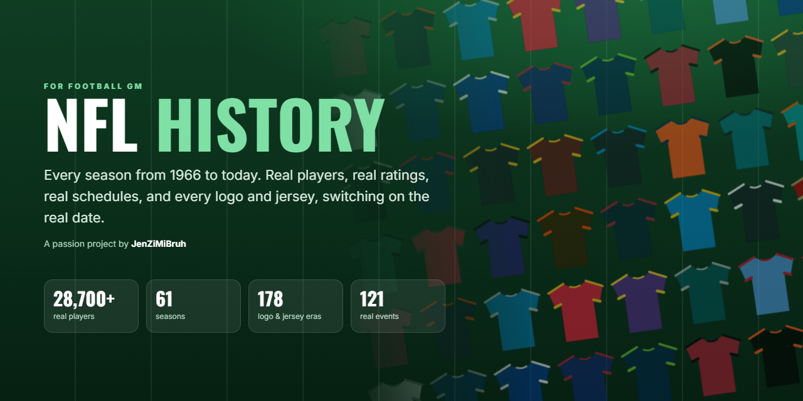

  
  
  
  
  

<h3 align="center">
  <a href="https://jenzimibruh.github.io/nfl-history-fbgm/download.html">⬇️ Download</a> &nbsp;·&nbsp;
  <a href="https://jenzimibruh.github.io/nfl-history-fbgm/">🌐 The site</a> &nbsp;·&nbsp;
  <a href="https://jenzimibruh.github.io/nfl-history-fbgm/updates.html#vote">🗳️ Vote on what's next</a> &nbsp;·&nbsp;
  <a href="CHANGELOG.md">🆕 What's new</a> &nbsp;·&nbsp;
  <a href="https://github.com/JenZiMiBruh/nfl-history-fbgm/issues/new/choose">🐞 Report a bug</a>
</h3>

<b>Every NFL season since 1966 for <a href="https://football-gm.com">Football GM</a>.</b> Real players with ratings built from their real careers, real schedules and drafts, every logo and jersey switching on the real date, and the things that really happened: moves, expansions, retirements, comebacks and suspensions.

🧪 <b>Beta:</b> it works, but you may still hit bugs. <a href="#known-issues">Known issues</a> are listed below; anything else, <a href="https://github.com/JenZiMiBruh/nfl-history-fbgm/issues/new/choose">report it</a> and it gets fixed in the next update.

---

## Pick how you play

<table>
<tr>
<td width="33%" valign="top">
<h3>⚡ This season</h3>
The real 2026 season as of the latest week, with all of history behind it.  
✅ Regular Football GM ✅ Phone or computer ⏱️ 2 minutes  
<a href="#-this-season"><b>How →</b></a>
</td>
<td width="33%" valign="top">
<h3>📅 Any season</h3>
Start in 1985, 2007, any year from 1967: preseason, any week, the playoffs or draft day.  
✅ Regular Football GM ✅ Built in your browser ⏱️ 5 minutes  
<a href="#-any-season"><b>How →</b></a>
</td>
<td width="33%" valign="top">
<h3>🏈 The mod</h3>
History keeps happening after day one: real schedules, drafts, careers and events.  
✅ Every season built in ✅ Updates itself ⏱️ 10 minutes, once  
<a href="#-the-mod"><b>How →</b></a>
</td>
</tr>
</table>

<a href="https://jenzimibruh.github.io/nfl-history-fbgm/download.html">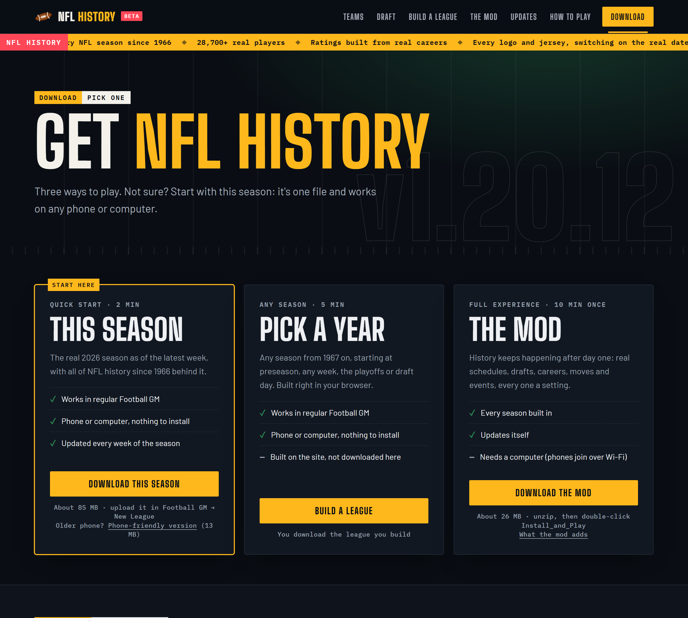</a>

## Why this exists

I've played Football GM since 2020. Basketball GM is what got me into NBA history and stats: real players, real ratings, portraits, logos and jersey history going back decades. You can start in 1985 and see if you'd have drafted Jordan.

Football GM didn't have any of that, so I built it. — **JenZiMiBruh**

## How to play

### ⚡ This season

The real 2026 season as of the latest week: standings, stats, rosters and injuries, with all of NFL history since 1966 behind it. Updated every week of the season.

1. **Download** this season from the [Download page](https://jenzimibruh.github.io/nfl-history-fbgm/download.html). Don't unzip it. Older or low-memory phone? Get the phone-friendly version there (13 MB).
2. **Open** [play.football-gm.com](https://play.football-gm.com) and tap **New League**.
3. In the **Customize** box, change **Default** to **Upload league file** and choose the file.
4. **Pick your team** and tap **Create league**.

Show me every screen

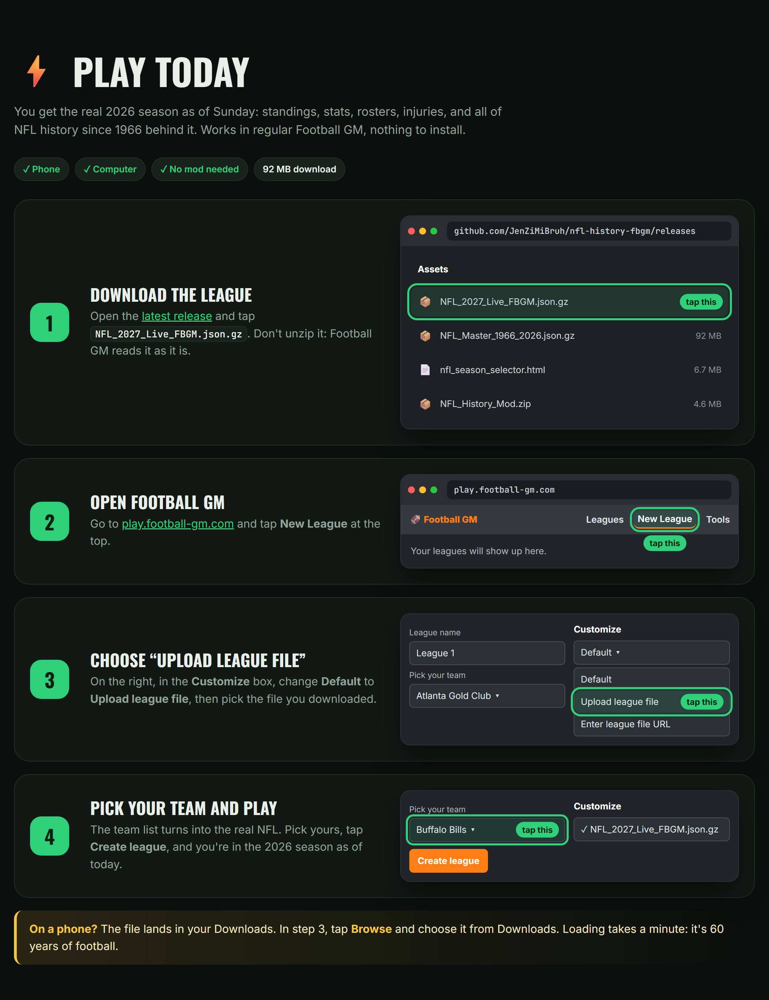

### 📅 Any season

Any season from 1967 on, at any start point: **preseason**, **any week** (real results already played), **the playoffs**, **after the playoffs** (real champion and awards) or **draft day** (real draft order).

1. **Open** [Build a league](https://jenzimibruh.github.io/nfl-history-fbgm/build.html) and tap **Load NFL history**.
2. **Pick** a season, a start point and the real events you want, then **Generate & download**.
3. **Upload** it in Football GM, same as above.

Offline? Get the offline selector and the seasons file from the [Download page](https://jenzimibruh.github.io/nfl-history-fbgm/download.html) and drop the seasons file on the selector.

Show me every screen

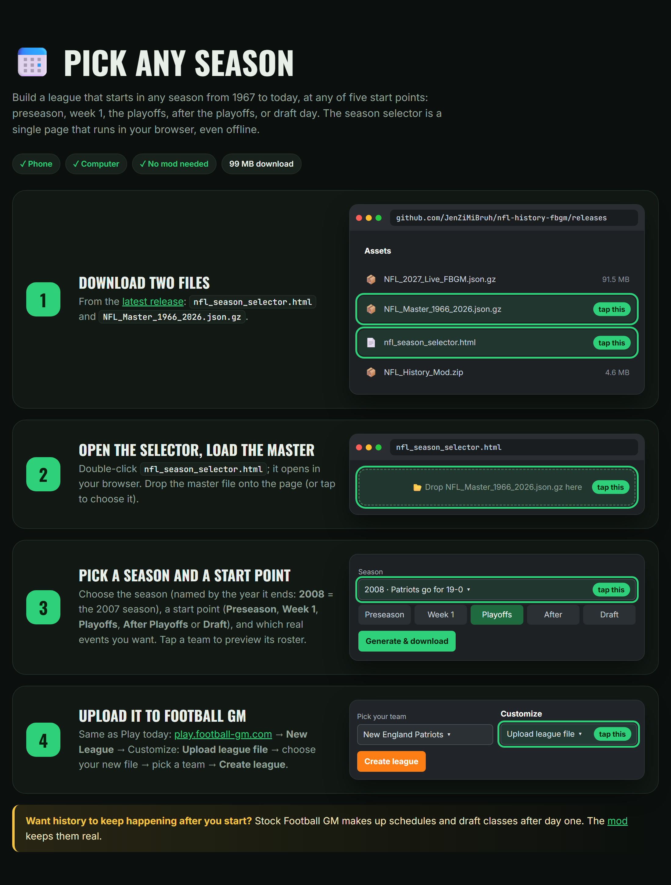

### 🏈 The mod

Everything above, plus history that keeps happening: the real schedule every season, real drafts, careers that follow the real one, real retirements, comebacks and suspensions, with a setting for each.

1. **Download** the mod from the [Download page](https://jenzimibruh.github.io/nfl-history-fbgm/download.html) and unzip it.
2. **Double-click** `Install_and_Play.bat` (Mac or Linux: `install_and_play.sh`). The first run sets up in 5–10 minutes.
3. The game opens in your browser. In **New League**, the **NFL History** box lets you pick any season.
4. **On your phone**, open the address the window shows, on the same Wi-Fi.

The mod checks for updates every time you start it and shows what's new.

Show me every screen

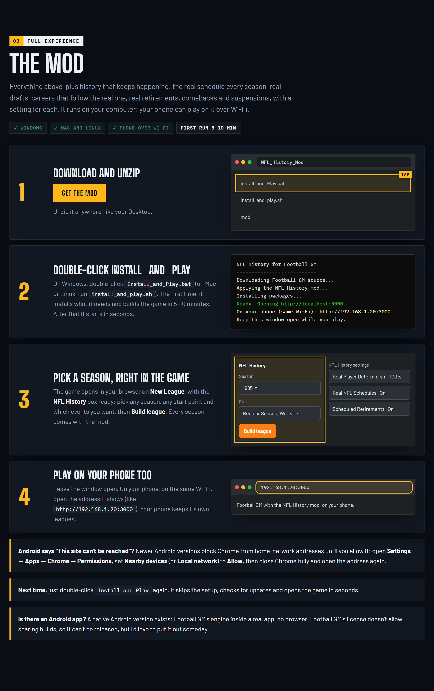

> Seasons are named the way Basketball GM names them, by the year they end: 2008 is the 2007 season.

## Things to try

| | |
|---|---|
| 🏆 **Go 19-0** | Start in 2007 with the Patriots. Same roster, same schedule. Finish what they couldn't. |
| 🦁 **Keep Barry Sanders** | Start in 1999 and talk him out of retiring. How many yards does he end with? |
| 🐻 **Run it back with the '85 Bears** | Can Ditka's defense win more than one ring? |
| 🏈 **Draft Arch Manning** | Start today and sim to April. The real 2027 class is waiting. |
| 🔁 **Rewrite a relocation** | Keep the Oilers in Houston or the Browns in Cleveland, and see who becomes a dynasty. |
| 📈 **Turn history off** | Set Real Player Determinism to 0 and watch 60 years of football go sideways. |

## Your team's history

Every franchise has its own page on the **[NFL History site](https://jenzimibruh.github.io/nfl-history-fbgm/teams.html)**: every logo and jersey, every season's record, and every notable player with his rating season by season. Everything below is a real screenshot.

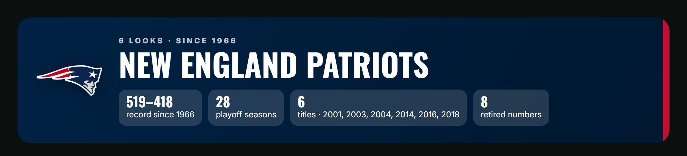

### Every logo and jersey, switching on the real date

146 looks across 32 franchises, built into the league file. Start in 1976 and the Bucs are creamsicle orange; sim to 1997 and they switch on the real date. The Oilers become the Titans, the Rams go to St. Louis and back, and the Titans unveil the Shield in 2026.

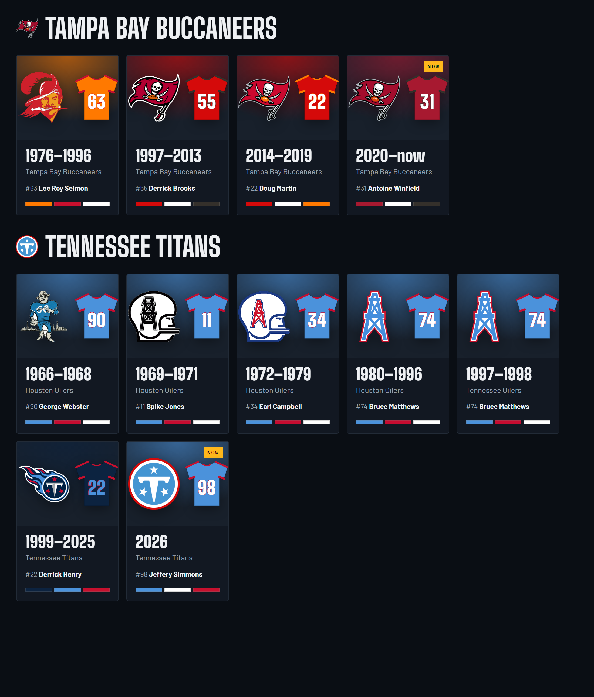

<b>The Rams: 14 looks</b>

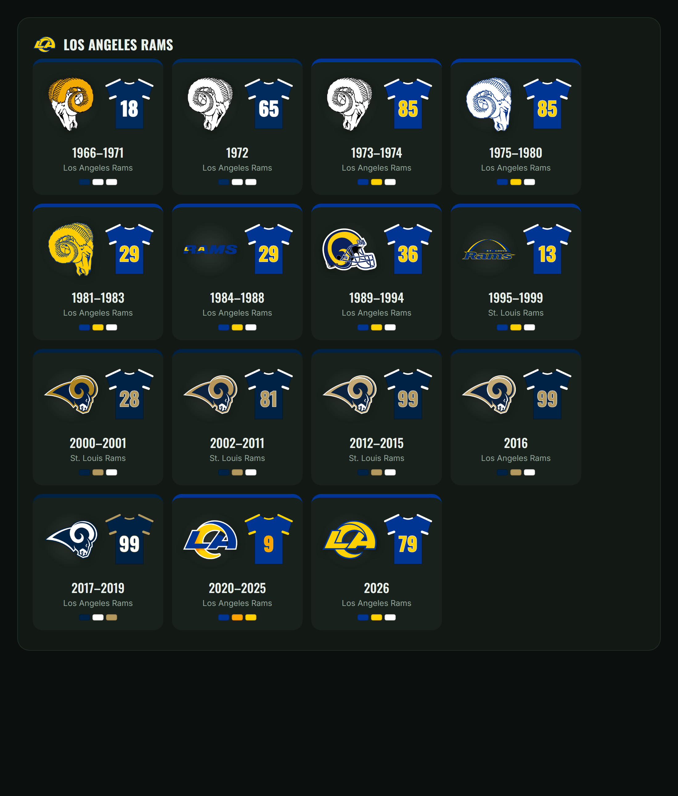

### Every season, every rating

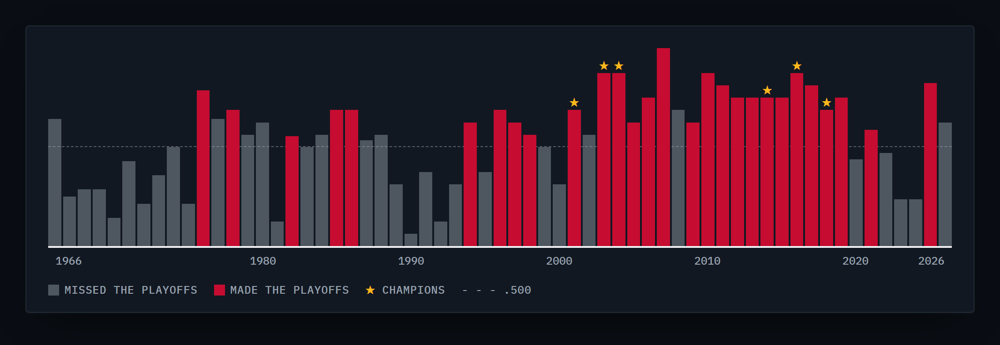

Pick any season and see who mattered, rated from what they really did. The 2007 Patriots:

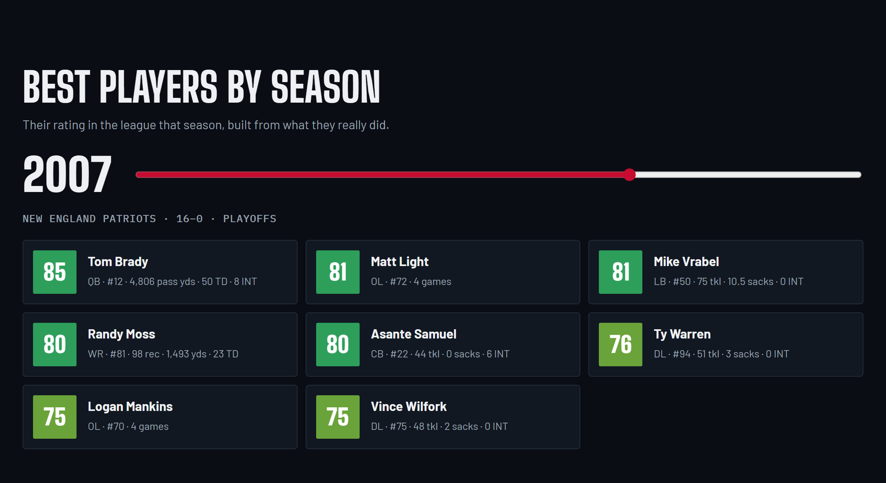

<table><tr>
<td width="56%">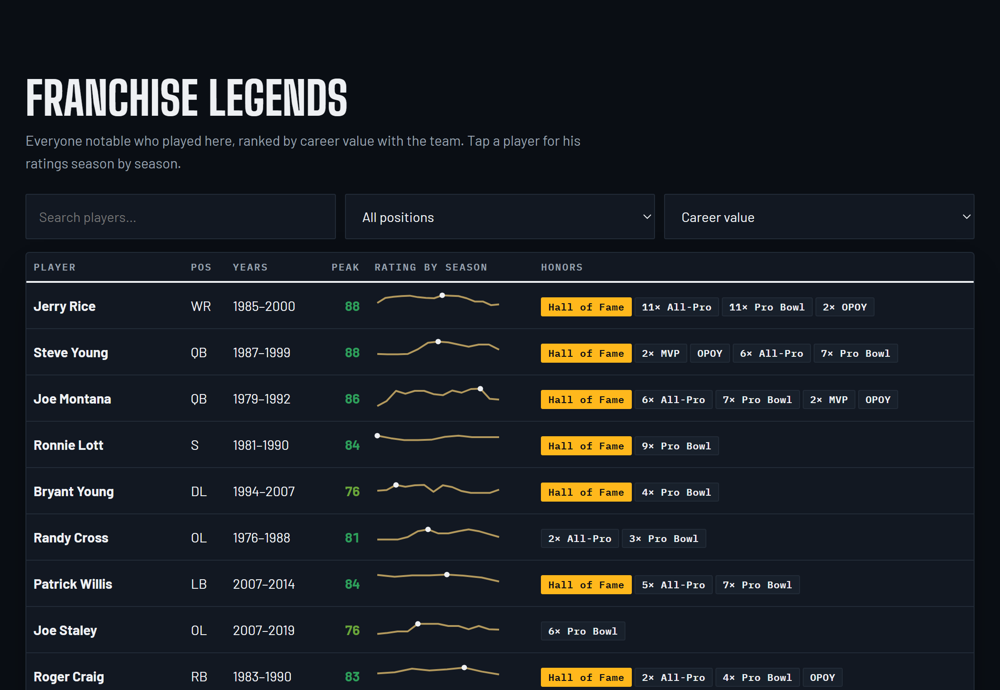</td>
<td width="44%">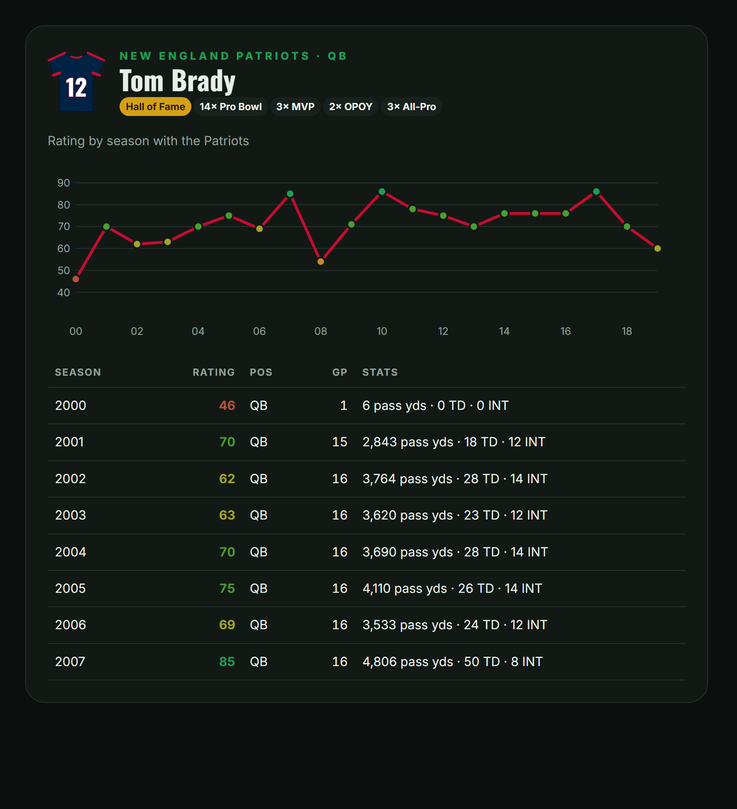</td>
</tr></table>

## The real next three drafts

Sim past today and you're not drafting made-up players. The 2027, 2028 and 2029 classes are **1,020 real college players** with their real schools, hometowns and headshots, ranked from college production, recruiting pedigree and where their position really goes. The top of 2027 follows ESPN's big board ([how](docs/draft-classes.md)).

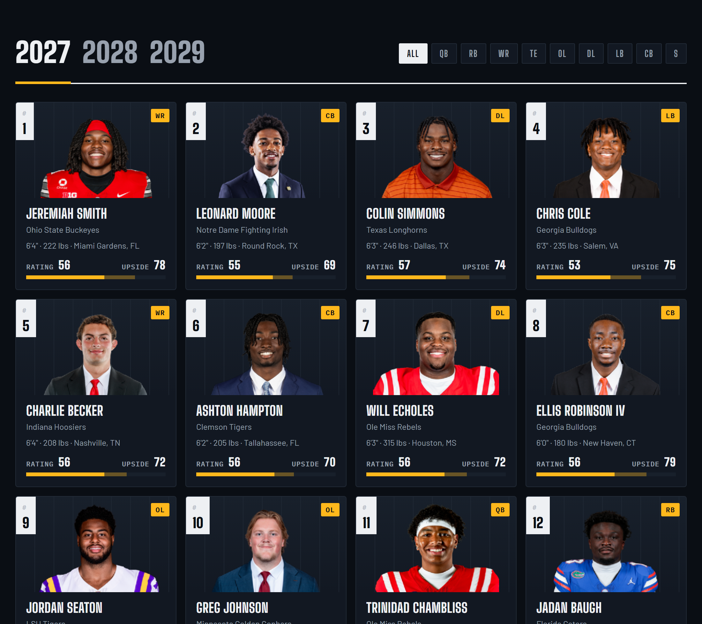

## What's in the league

| | |
|---|---|
| 🧑‍🤝‍🧑 **28,700+ real players** | Season stats from 1966 on: passing, rushing, receiving, defense, kicking by distance, punting, returns, playoffs |
| ⭐ **Ratings for everyone** | Built from real production, including players with almost no stats; real returners return kicks ([how](docs/ratings.md)) |
| 👨‍👦 **Families** | 435 players linked to their fathers, sons and brothers: the Mannings, the Sanders, the Watts, the Bosas. The Relatives page works out grandfathers, uncles and cousins |
| 🏆 **Awards & honors** | MVP (with the AFL's before the merger), OPOY/DPOY, rookies, Super Bowl MVP, All-Pro, Pro Bowl, Hall of Fame by induction year, retired numbers |
| 🎨 **Logos & jerseys by era** | 146 looks in high resolution, with today's uniforms matched to the real 2026 ones |
| 🗓️ **Real schedules** | Every game since 1966, in order, including the pre-merger AFL and NFL and the strike seasons |
| 📰 **121 real-life events** | Each with its reason: retirements, comebacks, suspensions (Deflategate), relocations and expansions |
| 🔴 **This season, live** | Standings, stats, rosters, injured reserve and injuries, updated every week |
| 📸 **Player photos** | Real headshots for 4,000+ players and every draft prospect |
| 🎓 **Real draft classes 2027–2029** | 1,020 real college players ([how](docs/draft-classes.md)) |

## The mod: settings for everything

The league file works anywhere, but stock Football GM forgets history the moment you sim: it makes up schedules, drafts fictional rookies, and players develop at random. The mod fixes that, and every piece is a setting, on the New League screen and later in **Settings → Real Players**.

| | |
|---|---|
| 📈 **RPD** | Real Player Determinism: careers follow the real one, on a slider from random to exactly real |
| 🗓️ **Real schedules** | Every real game, in order, since 1966 |
| 🎯 **Real drafts** | The real players go to the teams that really took them |
| 📰 **Real events** | Retirements, comebacks, and suspensions for the real number of games, during the season when they really happened |
| 🔁 **Moves on the real date** | The Browns' players and picks move to Baltimore in 1996, expansion drafts, mid-season trades, numbers retired when they really were |
| ⚙️ **Era calibration** | Seven sim factors retuned every season: 1972 plays like 1972 |
| 🎨 **Your team's colors** | The whole interface takes your team's colors, and changes when theirs do |
| 🗳️ **Have your say** | A one-tap poll on the What's new screen: vote on what gets built next |

### RPD: careers that follow the real one

Turn Real Player Determinism up and Jerry Rice still plays into his 40s and Barry Sanders still walks away at 31. Turn it down and history gets a reroll.

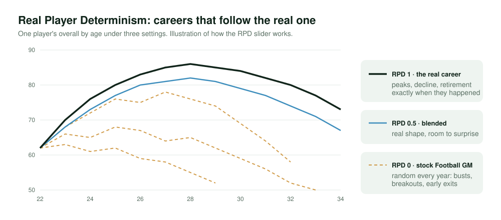

### Real schedules: every real game, in order

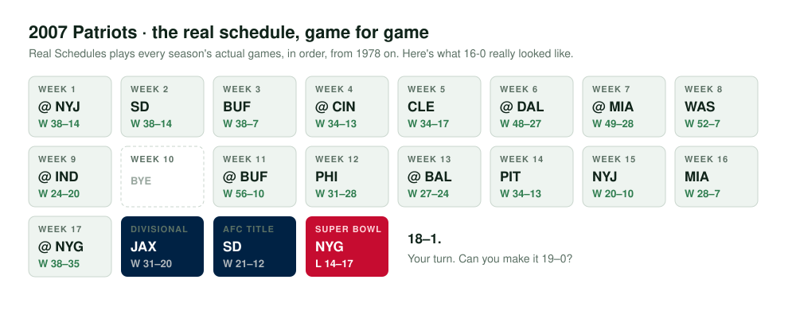

## Does it hold up?

The test: start in 1966, sim all the way to today, and compare with what really happened.

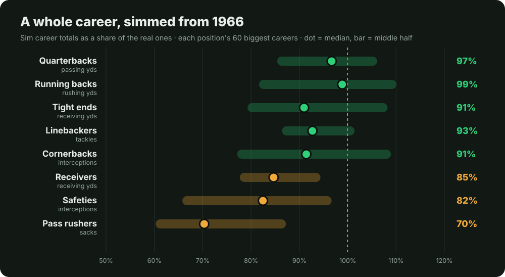

- League-wide stats per era land within a few tenths of real
- Team ratings line up with real records (median correlation 0.83 by season), and 94% of All-Pros rate top 5 at their position
- Quarterbacks finish at 97% and running backs at 99% of their real careers (median)

Details in [docs/results.md](docs/results.md).

## Known issues

It's a beta, so here's what's known and not fixed yet. Seen something not on this list? [Report it](https://github.com/JenZiMiBruh/nfl-history-fbgm/issues/new/choose).

| Issue | Where | Details |
|---|---|---|
| **The Browns' move needs the mod** | Regular Football GM | Football GM can't move a team without its history, so in a league from 1995 or earlier the Browns' players go to free agency and Baltimore holds an expansion draft. History stays right in Cleveland. [Why, and vote on it](#faq) |
| **Arch Manning isn't linked to his family** | Everywhere | His tie to Archie, Peyton and Eli runs through his father Cooper, who didn't play, so Football GM can't connect them |
| **Practice-squad call-ups** | Leagues starting mid-season, mostly 2020–21 | Football GM has no practice squad. Players who were only called up for games may start as free agents |
| **Late-season events happen at the trade deadline** | The mod | Football GM runs events between phases, so something from December (Marshawn Lynch's 2019 return) happens at the trade deadline |
| **Hall of Fame after your start season** | The mod | Football GM picks new Hall of Famers with its own formula when they retire, like Basketball GM does, not on their real induction date |
| **Existing leagues keep their data** | Everywhere | Fixes reach new leagues. Download again and start a new league to get them |

Fixed recently: see the [changelog](CHANGELOG.md).

## Roster updates & timeline

Like Madden, the league is updated all year: **a roster update every week of the season** (stats, signings, trades, injuries, ratings), then free agency in March, the real draft in April, the schedule in May, and a **new season release every August**. Full schedule in [docs/roadmap.md](docs/roadmap.md). Want a say in what comes next? [Vote on the site](https://jenzimibruh.github.io/nfl-history-fbgm/updates.html#vote), no account needed.

## How it was built

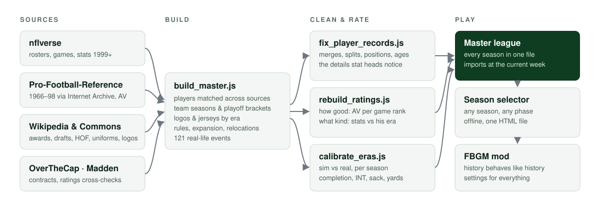

The hard parts, and why each decision was made. Each has its own deep dive with charts.

<table>
<tr><td width="50%" valign="top"><a href="docs/ratings.md">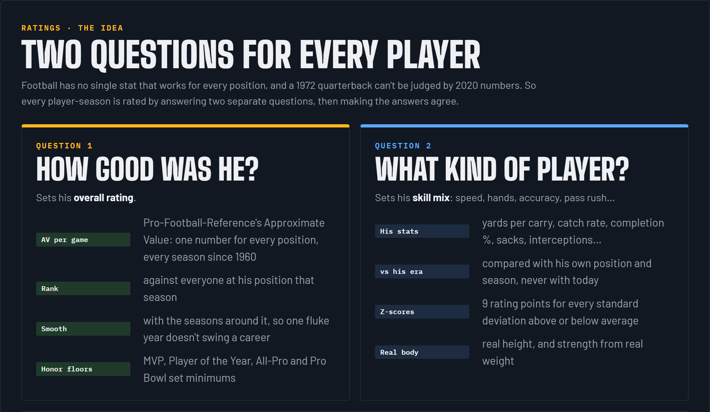</a> <b><a href="docs/ratings.md">How every player is rated →</a></b> Approximate Value for how good, his stats against his era for what kind, with a full Barry Sanders worked example</td><td width="50%" valign="top"><a href="docs/ratings.md#step-4-the-curve">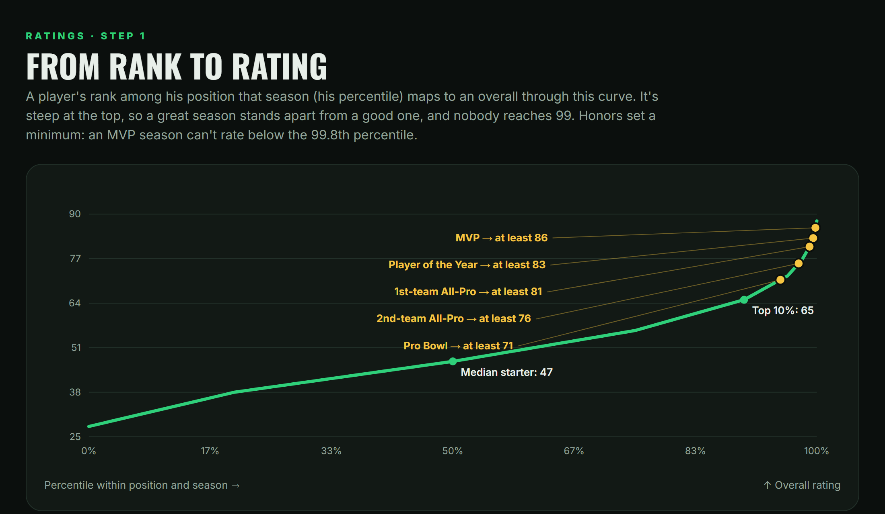</a> <b><a href="docs/ratings.md#step-4-the-curve">From rank to rating →</a></b> Why stars land in the 80s, nobody is a 99, and an MVP can't rate below 86</td></tr>
<tr><td width="50%" valign="top"><a href="docs/sources.md">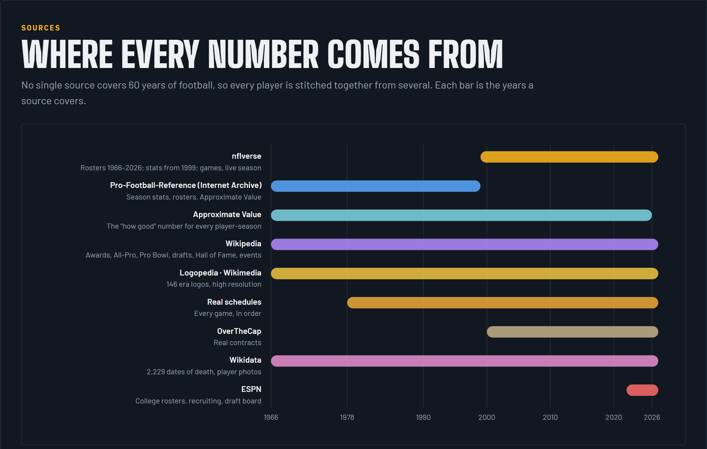</a> <b><a href="docs/sources.md">Where every number comes from →</a></b> Nine sources stitched together, from archived Pro-Football-Reference pages to Wikidata</td><td width="50%" valign="top"><a href="docs/calibration.md">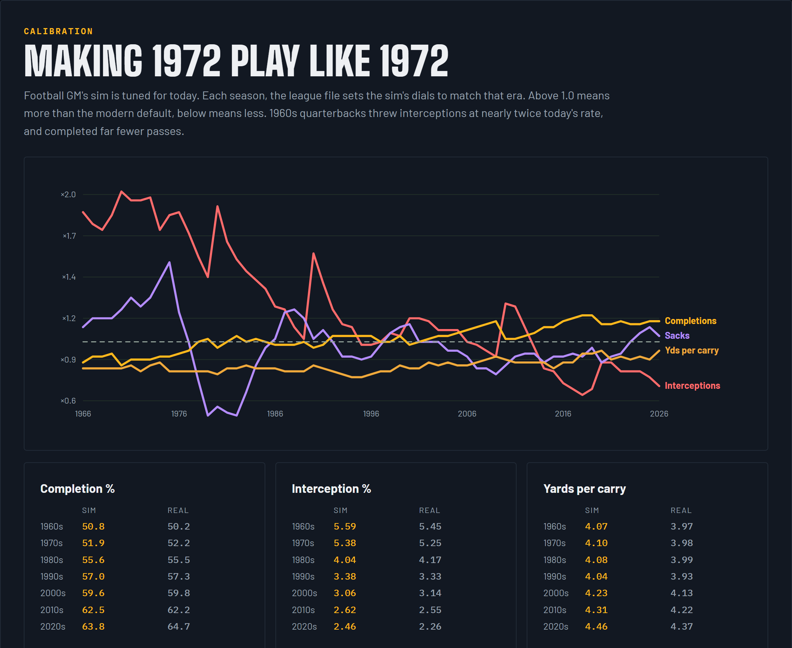</a> <b><a href="docs/calibration.md">Making 1972 play like 1972 →</a></b> The sim's dials set season by season, checked against a 60-season sim</td></tr>
<tr><td width="50%" valign="top"><a href="docs/data-fixes.md">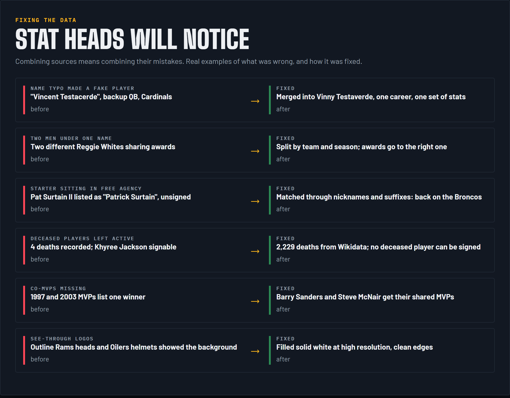</a> <b><a href="docs/data-fixes.md">Stat heads will notice →</a></b> Fake players, merged namesakes, co-MVPs, deaths, see-through logos, and how each was fixed</td><td width="50%" valign="top"><a href="docs/draft-classes.md">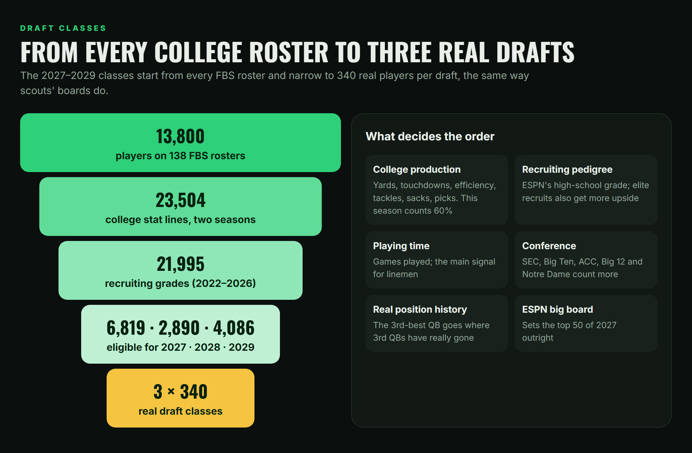</a> <b><a href="docs/draft-classes.md">The real next three drafts →</a></b> From 13,800 college players to three real classes of 340</td></tr>
</table>

And [the mod](mod/): every file it touches and why.

## FAQ

<b>Do I need the mod?</b>

No. This season's file and any season from the selector work in regular Football GM. The mod is what keeps history behaving like history after you start simming: real schedules, real drafts, real careers and events.

<b>What happens to the Browns and Ravens in 1995-96?</b>

After the 1995 season, Art Modell moved the Browns to Baltimore. The NFL's 1996 agreement kept the Browns' name, colors and history in Cleveland, so Baltimore started as a new team (the Ravens), and Cleveland came back in 1999 as the Browns with all of their history.

- **With the mod:** the Browns' players, contracts and draft picks move to Baltimore with the franchise, like they really did. Cleveland's history stays in Cleveland, and the Browns come back in 1999 with an expansion draft.
- **In regular Football GM:** Football GM can't move a team without moving its history. So the Browns' history stays right in Cleveland, but the 1995 Browns become free agents and Baltimore builds its roster in an expansion draft.

Why not move the team and its history? Then the Browns' 1966-95 records, players and Hall of Famers would belong to the Ravens, which isn't true. Think regular Football GM should do it the other way? [Vote on the site](https://jenzimibruh.github.io/nfl-history-fbgm/updates.html#vote).

<b>Does it work on my phone?</b>

Yes. Download this season or build any season on the site, then upload it in Football GM's New League screen. The mod runs on a computer, and your phone can play on it over Wi-Fi.

<b>How current is this season's file?</b>

It's updated every week of the season with every final score, stat line, roster move and injury. Games still to be played stay on the schedule.

<b>Why is the 2008 season called 2009?</b>

Football GM, like Basketball GM, names a season by the year it ends. The 2008 NFL season ends with the Super Bowl in February 2009.

<b>How do I vote, and can I see the results?</b>

On the site's [Updates page](https://jenzimibruh.github.io/nfl-history-fbgm/updates.html#vote), or at the bottom of the mod's What's new screen. No account needed: one vote in each poll. Results show after you vote, so the current leader doesn't sway anyone.

<b>How do I uninstall the mod?</b>

Double-click `Uninstall.bat` in the mod folder (Mac or Linux: `uninstall.sh`). It stops the game and deletes the folder: the mod, the downloaded Football GM files and its private copy of Node.js. Nothing else on your computer is touched.

Your leagues are saved in your browser, not in the folder: to delete them, delete them from the game's **Leagues** page before you uninstall.

<b>Something's wrong with a player or a logo. Where do I report it?</b>

Every player card and team page on the site has a one-tap report link. Or [open an issue](https://github.com/JenZiMiBruh/nfl-history-fbgm/issues/new/choose) with the player, the season and what's off. Accuracy is the whole point.

## Building from source

Needs Node 18+. The scripts in [`src/`](src/) rebuild everything from raw data; the full order and options are in [docs/building.md](docs/building.md).

## Thank you

To the creator of [Football GM](https://football-gm.com) and [Basketball GM](https://basketball-gm.com): thank you for the amazing games and all the work you've put into them over the years. None of this exists without them.

## Credits

- **[nflverse](https://github.com/nflverse)**: rosters, games, modern stats and the live season
- **[Pro-Football-Reference](https://www.pro-football-reference.com)** via the **Internet Archive**: 1966–98 stats and Approximate Value
- **Wikipedia, Wikidata & Wikimedia Commons**: awards, drafts, Hall of Fame, retired numbers, families, uniforms, logos
- **ESPN**: college rosters, recruiting grades, draft board and headshots
- **OverTheCap** (contracts), **spreadspoke** (scores), **Logopedia** (logos)

Team names and logos belong to the NFL and its teams. This is a fan project for personal play, not affiliated with or endorsed by the NFL or Football GM.

Made with way too many hours and a lot of love by <b>JenZiMiBruh</b>, a Cardinals fan who has made peace with it. Psst: try the Konami code on the site. And look up Larry Fitzgerald. <b>Thank you, dumbmatter.</b>

