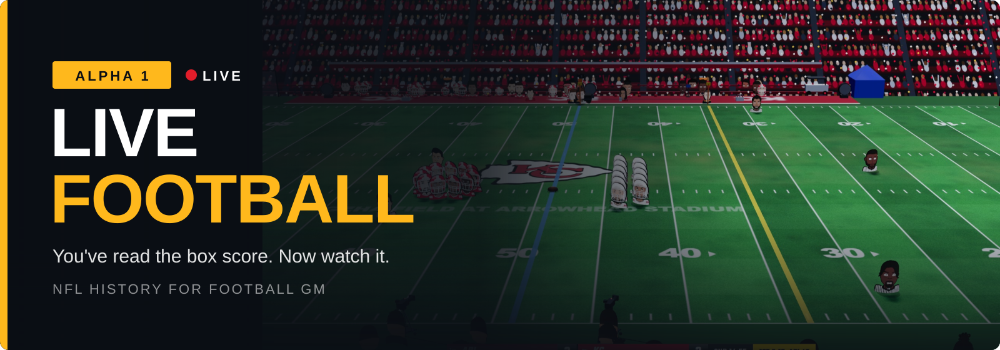
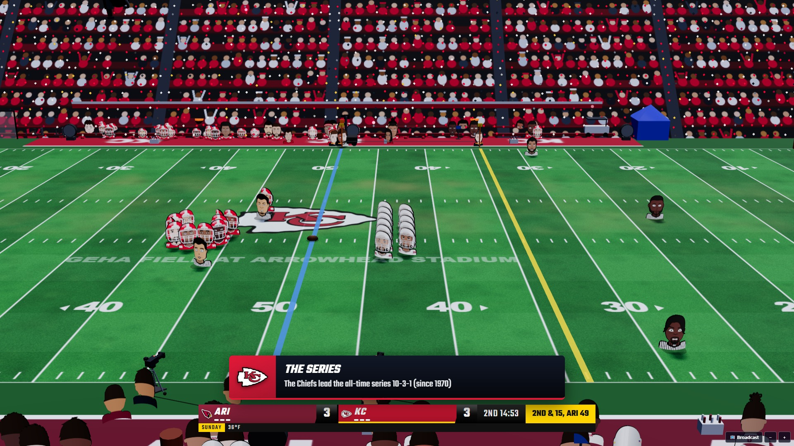
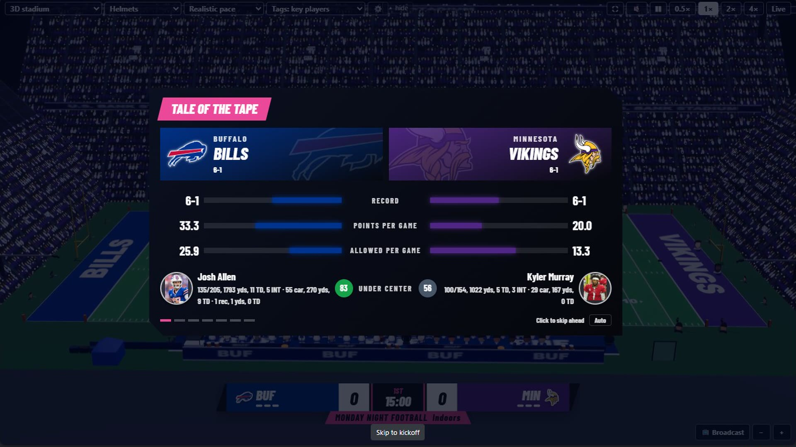
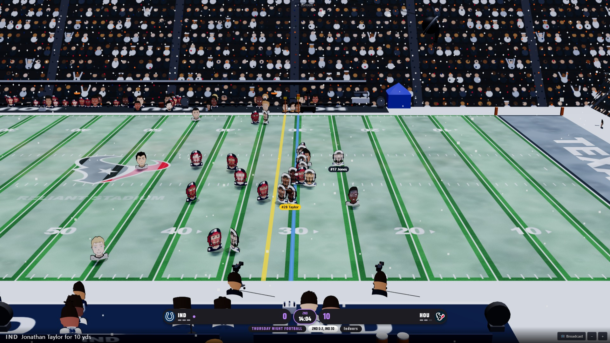
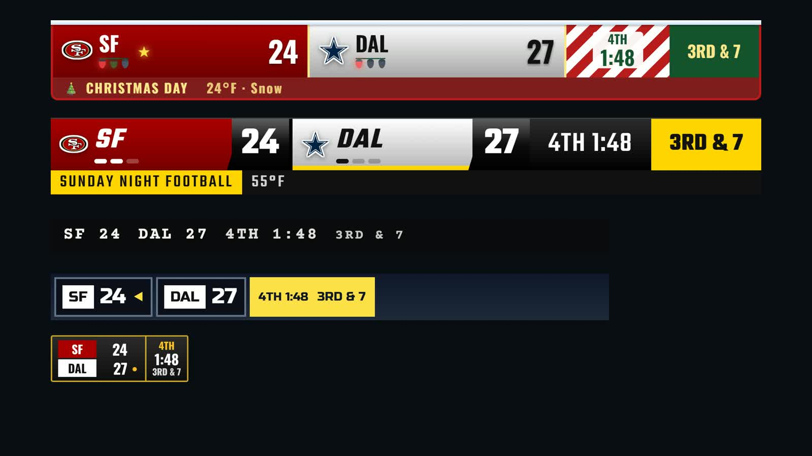

  
  
  
  
  

<h3 align="center">
  <a href="https://github.com/JenZiMiBruh/nfl-history-fbgm/releases/tag/live-alpha-2">⬇️ Download the alpha</a> &nbsp;·&nbsp;
  <a href="https://jenzimibruh.github.io/nfl-history-fbgm/live.html">🌐 Live on the site</a> &nbsp;·&nbsp;
  <a href="#-known-issues">🧪 Known issues</a> &nbsp;·&nbsp;
  <a href="https://github.com/JenZiMiBruh/nfl-history-fbgm/issues/new/choose">🐞 Report a bug</a> &nbsp;·&nbsp;
  <a href="https://github.com/JenZiMiBruh/nfl-history-fbgm">🏠 The main mod</a>
</h3>

<b>Every game in your Football GM league, played out on the field.</b> Football GM's own sim still calls every play. Live Football acts it out, snap by snap, with a TV broadcast around it: the open, the pregame, score bugs, replays and the big-play graphics.

---

## 🎬 The trailer

<b><a href="https://youtu.be/osboZgSy4L8">▶ Watch the trailer</a></b>

---

## Pick how you watch

<table>
<tr>
<td width="33%" valign="top">
<h3>📺 Broadcast</h3>
The full 3D view: a stadium, the crowd, lights and weather, and broadcast cameras following the ball.  
✅ The whole show 💻 Best on a computer
</td>
<td width="33%" valign="top">
<h3>🛰️ Blimp</h3>
The overhead view, straight down on the field. Every route and every block, easy to follow.  
✅ Lightest to run 📱 Best on phones
</td>
<td width="33%" valign="top">
<h3>📋 Classic</h3>
The flat 2D field. Quick, clean, and the fastest way to get through a game.  
✅ Any device ⚡ Fastest
</td>
</tr>
</table>

## What's in the alpha

<table>
<tr>
<td width="50%" valign="top">

<h3>🏈 Every snap</h3>
Your real game, play by play: runs, passes, sacks, picks, punts, kicks and returns, each acted out to land exactly where the sim says.
</td>
<td width="50%" valign="top">

<h3>🎙️ The whole show</h3>
A game open, a pregame with the tale of the tape, lineups and leaders, replays, flags, and graphics for the big moments.
</td>
</tr>
<tr>
<td width="50%" valign="top">

<h3>🌨️ Real conditions</h3>
Afternoon light, night games, rain and snow.
</td>
<td width="50%" valign="top">

<h3>🏟️ The stadium</h3>
A full bowl with the crowd, video boards and light towers, and benches, coaches and camera crews on the sidelines.
</td>
</tr>
</table>

| | |
|---|---|
| 📊 **Score bugs** | Several original broadcast looks, plus Thanksgiving and Christmas versions |
| 🔁 **Replays** | The big plays again, after you've seen them |
| 🚩 **Flags** | The flag on the play, and the referee's call |
| 🗓️ **League calendar** | Every game's date and kickoff time, for the league and for your team |
| 🏆 **Championship banners** | A banner for every title on the team history page. Tap one to see it up close |
| 🎚️ **A switch for everything** | Each broadcast and field effect can be turned off in the Live view's settings |
| 🌍 **Any league** | NFL History leagues and random-player leagues alike |

Everything else is the regular [NFL History mod](https://github.com/JenZiMiBruh/nfl-history-fbgm): every season since 1966, 28,700+ real players, and logos and jerseys by era.

## How to play

1. **Already have NFL History?** Open it and click **Play the alpha now** on the announcement card. It switches by itself, and your leagues stay where they are.
2. **New here?** [Download the alpha](https://github.com/JenZiMiBruh/nfl-history-fbgm/releases/tag/live-alpha-2) (`NFL_History_Mod.zip`), unzip it, and double-click `NFL History.exe` (Mac or Linux: `install_and_play.sh`). The first run sets up in 5–10 minutes.
3. The game opens in your browser. Start or open a football league, and **watch any game** from the schedule.
4. **On your phone**, scan the QR code in the window, or open the address it shows, on the same Wi-Fi. The blimp view is the smoothest there.

> Want to go back? Click **Back to the regular mod** in the bar at the bottom of any page. The game switches over by itself.

## Things to try

| | |
|---|---|
| 🏆 **Watch 19-0** | Start in 2007 with the Patriots and watch every game of the run. |
| ❄️ **A December game in the snow** | Sim to late in a season and watch a cold-weather game at night. |
| 🦃 **Thanksgiving football** | Watch a Thanksgiving game and catch the holiday score bug. |
| 🛰️ **The blimp on your phone** | Open the game on your phone and switch to the overhead view. |
| 🎚️ **Strip it down** | Turn every effect off in settings and watch just the football. |

## 🧪 Known issues

It's an alpha, so here's what's known and not fixed yet. Seen something not on this list? [Report it](https://github.com/JenZiMiBruh/nfl-history-fbgm/issues/new/choose).

| Issue | Details |
|---|---|
| **Fan cams** | The crowd camera shots don't work right yet |
| **The QB walkout** | The quarterback's walk out to the field isn't smooth yet |
| **Huddle shuffle** | Players can slide sideways as a group in the huddle before they break |
| **Sideline clipping** | People and props on the sidelines can overlap |
| **Sideline zooms** | The camera sometimes zooms on the sideline for no reason |
| **The ball and the crowd** | Both are simple for now and will look better |
| **Phones** | The 3D view can be slow on older phones: use the blimp or classic view |

## FAQ

<b>Does Live Football change my results?</b>

No. Football GM's sim decides every play, exactly as before. Live Football only shows it: the animation always ends where the sim says, and nothing on screen tells you a result before the play happens.

<b>Will my leagues still be there?</b>

Yes, if you switch to the alpha from inside the mod. Leagues are saved in your browser, and both versions use the same one. A fresh download in a new folder opens at a different address, so it starts with no leagues.

<b>Does it work with the league files for regular Football GM?</b>

No. Live Football comes with the mod. The league files for regular Football GM won't have it.

<b>How do I report a bug?</b>

[Open an issue](https://github.com/JenZiMiBruh/nfl-history-fbgm/issues/new/choose) with what happened, the two teams and the game's date. A screenshot helps a lot.

## Thank you

To the creator of [Football GM](https://football-gm.com) and [Basketball GM](https://basketball-gm.com): none of this exists without the game and its sim. And to everyone testing the alpha: thank you for every bug report.

Team names and logos belong to the NFL and its teams. This is a fan project for personal play, not affiliated with or endorsed by the NFL or Football GM.

Made with way too many hours and a lot of love by <b>JenZiMiBruh</b>. <b>Thank you, dumbmatter.</b>

