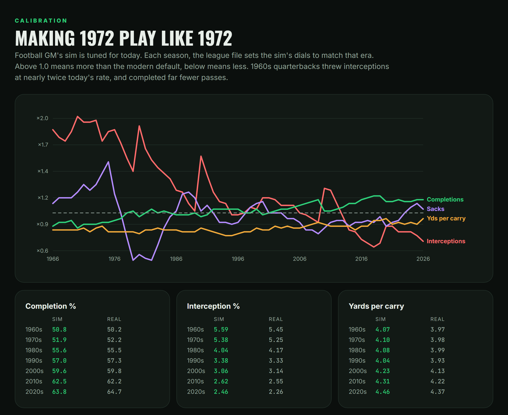

# Calibration

Football GM's game sim is tuned for the modern NFL. Run 1972 through it and quarterbacks complete passes like it's 2020, and almost nobody throws interceptions.

## Era factors

Football GM has tuning settings for completions, interceptions, sacks, fumbles, yards per carry, yards per catch and run/pass mix. The league file changes them every season through scheduled events.

[`calibrate_eras.js`](../src/calibrate_eras.js) sets them:

1. Sim the whole history, 1966 to today.
2. For each factor, compare the sim's rate with the real one and scale by real ÷ simmed.
3. Real rates are smoothed over 5 seasons; simmed rates are pooled by decade, because one sim is too noisy per season.
4. Repeat on the next sim. Each pass starts from the last one's factors.

For 1966, for example: interceptions ×1.88, fumbles ×1.8, completions ×0.86, yards per carry ×0.82.

## Game sim changes

Some problems weren't about era. They were about who gets the ball, so the mod changes the sim itself:

| Problem | Change |
|---|---|
| Targets spread too evenly, so stars caught too little | Target weight follows receiver quality to the power 2.5 |
| Interceptions went to random players | Interceptions go to CBs, safeties and LBs by coverage, power 4, safeties ×1.8 |
| Sacks credited oddly | Sacks go to DL and LB by pass rush |
| Larry Fitzgerald ran the ball 157 times | Players play their real position first; depth chart position bonus +40 (stock is +15) |
| Rushing too efficient | Runs split 60/40 between runner and blocking; breakaways scale with runner quality |
| Committees instead of workhorse backs | The lead back gets ×4 weight and tires slower: about 18 carries a game, a 68% share |
| No trick plays | End-arounds on 3% of runs |

Every change was tested on the same teams with fixed random seeds, so the difference was the change, not luck.
