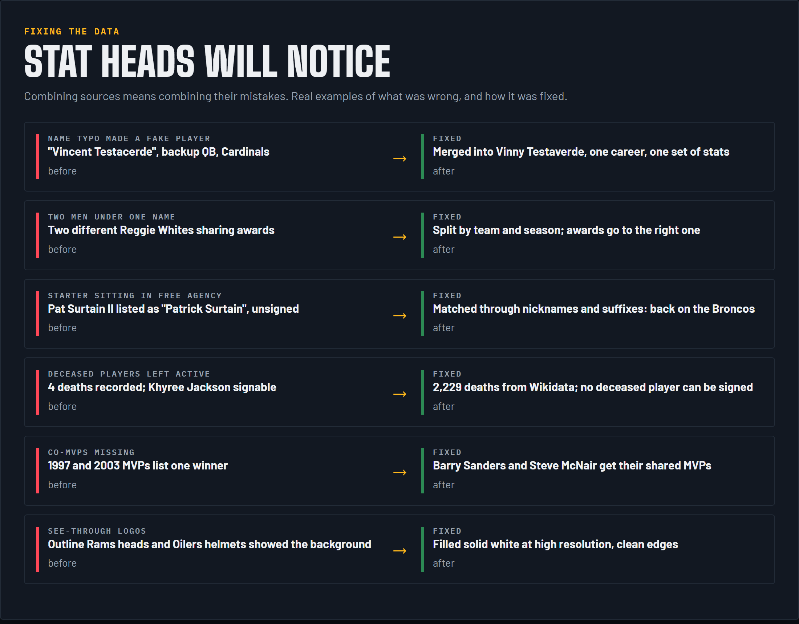

# Fixing the data

Combining sources means combining their mistakes. Stat heads *will* notice, so [`fix_player_records.js`](../src/fix_player_records.js) and [`fix_namesake_awards.js`](../src/fix_namesake_awards.js) fix them before ratings are built.

| Problem | Example | Fix |
|---|---|---|
| Name variants create a fake player | "Vincent Testacerde" at QB for the Cardinals | Merge players with the same name and birth year when one career fits inside the other, plus a nickname list (Vinny / Vincent) on the same team and season |
| Two players merged into one | Two men with one name, playing different positions the same year | Split, but only when the seasons really clash, so special-teams tackles don't cause false splits |
| Long gaps in a career | Years missing, then stats again under the same name | Split into separate players |
| Awards on the wrong namesake | Reggie White honors landing on the other Reggie White | Match awards by team and season; Hall of Fame years fixed too |
| Impossible ages | Players younger than 18 or older than 50 | Checked against debut year (George Blanda really did play at 48) |
| Wrong jersey numbers | Carson Beck wearing #6 | Real numbers per season from rosters; the real owner keeps his number in a clash |
| Deaths | 4 deaths recorded; Khyree Jackson, Marshawn Kneeland and Rondale Moore still signable | 2,229 dates of death from Wikidata (by Pro-Football-Reference ID, then name and birth year); deceased players retired |
| Co-MVPs | 1997 and 2003 MVP awards listed one winner | Barry Sanders and Steve McNair added as co-MVPs |
| Starters in free agency | Pat Surtain II and Mike Hall Jr. unmatched by name, left unsigned | Matching through nicknames and suffixes; both back on their teams |
| Draft years | Undrafted players listed as drafted in their debut year | Normalized per player |
| Positions and weights | One source's typo | Taken from the source with the most games |

| Playoff seeds | Saved seeds were positions, not real seeds | Real seeds from each season's playoff page, 1975 on; an order that reproduces the real games before that; the 1968 bracket repaired |
| Position listings | Late-career receivers rated as linemen, backup QBs as receivers | Each season takes the position and skills of his nearest correct season |
| Two Ron Smiths | A quarterback and a returner shared a record | Split into two players |
| Death data | Two wrong matches and games credited after death | Removed; exact dates and causes added where known |
| Seasons with no games | Players on injured reserve, suspended or holding out left their team | The real rosters keep them on it, out for the year |

| Wrong primary logos | Bears' C after 2023, a Giants anniversary logo for 1976-99, Jets' primary and secondary swapped from 2024 | Every era compared by eye against SportsLogos.net and Wikipedia ([`fix_logos_bears_giants.js`](../src/fix_logos_bears_giants.js)) |
| Secondary logos | One secondary for one team, applied to every season | `secondary: { tid: [{ from, to, data }] }` in the logo data, chosen per season. Off by default: the small logo is the primary unless the Secondary Logos option is on. Logo changes get a scheduled event ([`apply_logos_to_master.js`](../src/apply_logos_to_master.js), run by `finish_master`) |

| Contracts for shared names | Josh Allen and Lamar Jackson had no real contract | Match by position, then draft or birth year, allowing for drafts stored a year early, plus first-name variants ([`real_contracts.js`](../src/real_contracts.js)) |

| Contract amounts | Salaries were estimated tiers, then shrunk to fit the cap (Josh Allen about $30M) | The real deal's yearly pay from OverTheCap, capped at the game's maximum, with a soft cap from 2011 and 7% cap inflation after the real data ends |

Left alone on purpose: supplemental draft picks, namesakes who really were two people, real gaps in the sources, and Taysom Hill being whatever position Taysom Hill is.
