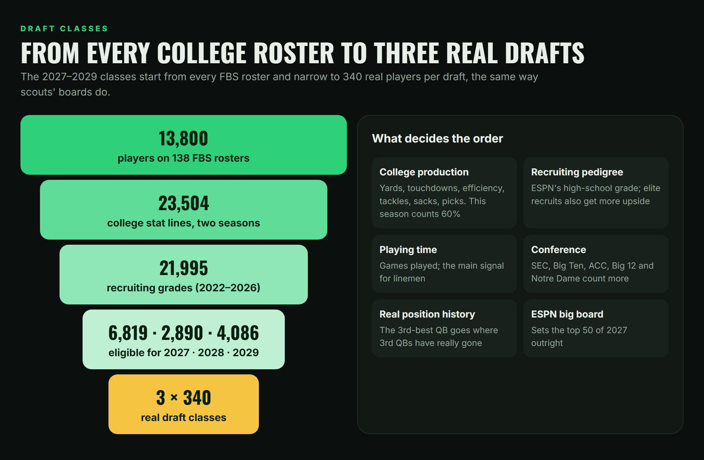

# Draft classes 2027–2029

Sim past today and the next three drafts are real college players, not generated ones.

## Who

Every FBS roster from ESPN's public college football data: real names, positions, heights, weights, schools, hometowns and headshots.

| Draft | Players |
|---|---|
| 2027 | Juniors and older |
| 2028 | Sophomores |
| 2029 | Freshmen |

340 per class: enough for all 224 picks plus undrafted free agents.

## Order

1. **College production** against his position and class: passing (volume and efficiency), rushing and receiving yards and touchdowns, tackles, sacks, tackles for loss, interceptions, passes defended, kicking. This season counts 60%, last season 40%.
2. **Playing time:** games played (for offensive linemen, the main signal).
3. **Recruiting pedigree:** ESPN's recruiting grade from high school, weighted about as much as production (elite recruits also get more upside).
4. **Conference strength:** SEC, Big Ten, ACC, Big 12 and Notre Dame count more.
5. **Where his position really goes:** the 1st, 2nd, 3rd... best player at each position is slotted where that rank has really been drafted in this league (2010–2024), so quarterbacks, edge rushers and kickers cluster the way they do in real drafts.
6. **ESPN's big board** sets the top of the 2027 class outright (Jeremiah Smith, Leonard Moore, Colin Simmons…).

## Ratings

A prospect's place in his class maps onto how real players drafted at that slot have rated in this league (rookie overall and career peak, 2008–2024 drafts). So the 5th prospect lands where real 5th picks do: about a 57 overall with a peak around 71.

His skill mix starts from a real rookie at his position with a similar rating. Height is his real height and strength follows his real weight. The position's skills then shift together until the league's own overall formula gives the target, the same solve [the historical ratings](ratings.md) use.

## Honest limits

- College stats can't see everything. Offensive linemen are ranked mostly by playing time and school, and freshmen have one season at most.
- Ages are estimated from class year (ESPN doesn't publish birth dates).
- A few players are slotted by hand where the formula misjudges them (Arch Manning, moved to QB3 / mid first round). Every override and its reason is listed in [`data/prospect_overrides.json`](../data/prospect_overrides.json).
- 2028 and 2029 will look different in real life as players transfer, break out or get hurt. Rerun `fetch_prospects.js` and `build_draft_classes.js` any time to refresh.

Code: [`src/fetch_prospects.js`](../src/fetch_prospects.js), [`src/build_draft_classes.js`](../src/build_draft_classes.js)
