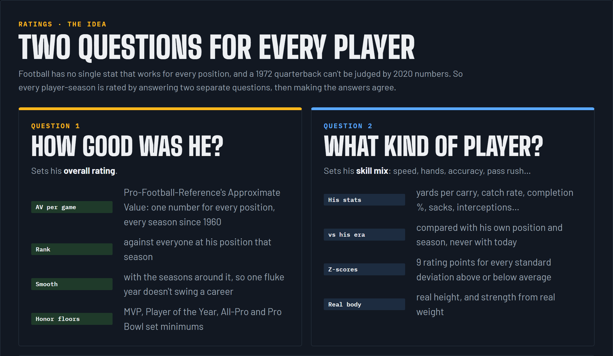
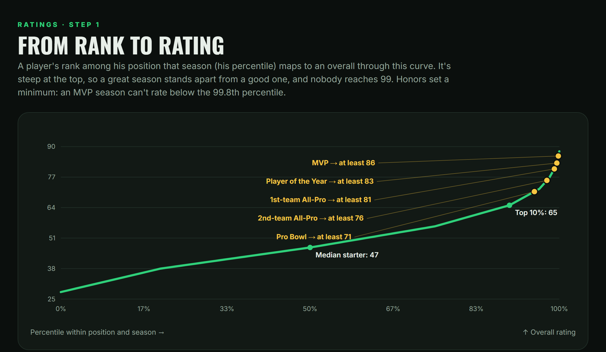
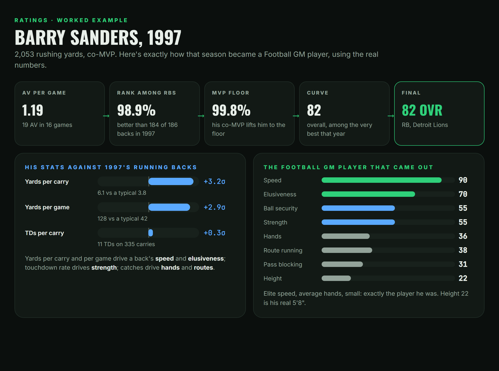
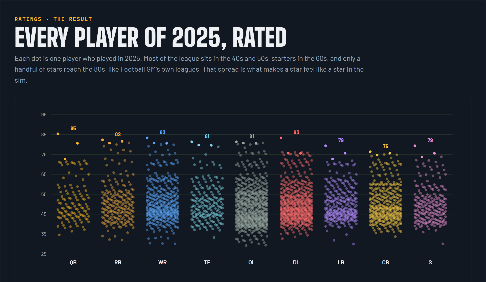
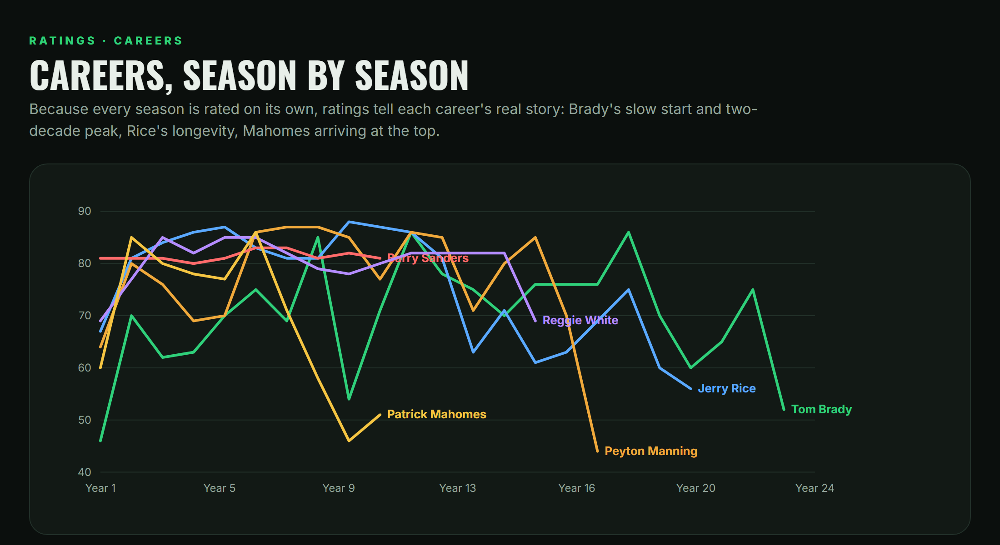

# How every player is rated

Basketball GM has an algorithm that turns real stats into ratings, so every real player has believable ratings, even a bench guy who played 40 minutes. Football GM had nothing like it, and football is harder:

- **Some positions have no stats at all.** A guard's box score is empty.
- **Eras change everything.** Completing 50% of your passes was good in 1972 and is unplayable today.
- **Some careers are tiny.** A lot of players have five career tackles.

This is how all 28,700+ players got ratings, using one method for every season from 1966 to today.

## Question 1: how good was he? (the overall)

### Step 1. Approximate Value per game

Pro-Football-Reference's **Approximate Value (AV)** is one number per player-season, for every position, back to 1960. It's the closest thing football has to a universal value stat. Two adjustments make it fair:

- **Per game,** so a star who missed half the season isn't rated like a backup.
- **Ranked within his position and season,** so a 1970s linebacker is compared with 1970s linebackers.

### Step 2. Smooth it

Each season's rank is blended with the seasons around it. One fluke year, up or down, doesn't swing a career, the same way scouts don't forget a player after one bad year.

### Step 3. Honors set a minimum

| Honor that season | Percentile floor | Overall floor |
|---|---|---|
| MVP | 99.8% | 86 |
| Offensive / Defensive Player of the Year | 99.5% | 83 |
| First-team All-Pro | 99% | 81 |
| Second-team All-Pro | 97.5% | 76 |
| Pro Bowl | 95% | 71 |

The voters who watched every game get a say. If a player made All-Pro, his rating can't come out below an All-Pro level.

### Step 4. The curve

The percentile maps to an overall through a curve that's gentle in the middle and steep at the top. A median starter lands around 47, the top 10% around 65, and only the very best seasons reach the 80s. Nobody is a 99: the scale tops out at 88, like Football GM's own leagues.

## Question 2: what kind of player was he? (the skills)

Each skill comes from the stats that show it, measured against **his own position and season**, never against today:

| Position | Stat → skill |
|---|---|
| **QB** | completion % → accuracy · yards per attempt → arm strength · TD rate, INT rate, sack rate → vision · rushing yards → speed and elusiveness · fumbles → ball security |
| **RB** | yards per carry and per game → speed and elusiveness · TD rate → strength · catches and catch rate → hands and routes · fumbles → ball security |
| **WR / TE** | catch rate → hands · catches and yards per game → route running · yards per catch → speed · fumbles → ball security |
| **DL** | sacks → pass rush · forced fumbles → pass rush · tackles → run stopping and tackling |
| **LB** | tackles → tackling and run stopping · sacks → pass rush · picks and passes defended → coverage |
| **CB / S** | interceptions and passes defended → coverage · tackles → tackling |
| **K / P** | FG %, long field goals → accuracy and power · yards per punt, inside the 20 → power and accuracy |

Each stat becomes a **z-score** (how many standard deviations above or below that season's average he was), and every standard deviation is worth **9 rating points** around the position's typical player. A stat needs enough volume to count: a back with 20 carries doesn't get elite speed from one long run.

**His body is real.** Height comes from his real height, and strength follows his real weight.

## Making the two answers agree

The skills that make up his position's overall shift **together** until Football GM's own overall formula lands exactly on Question 1's answer.

- **The shape comes from his stats:** fast but fumble-prone, accurate but weak-armed.
- **The level comes from how good he was.**

## Worked example: Barry Sanders, 1997

1. **AV per game:** 19 AV in 16 games, 1.19 per game, better than 184 of 186 backs that season (98.9%).
2. **MVP floor:** he was co-MVP with Brett Favre, which lifts him to the 99.8th percentile.
3. **Curve:** that lands at an **82 overall**.
4. **Skills:** his 6.1 yards per carry was 3.2 standard deviations above 1997's backs, and 128 yards a game was 2.9 above, so speed comes out at 90 and elusiveness at 70. His hands and routes sit near average, and his height rating is his real 5'8".

## What it adds up to

Every player who played in 2025, one dot each. Most of the league sits in the 40s and 50s, starters in the 60s, and a handful of stars reach the 80s. That spread is what makes stars feel like stars in the sim.

Because every season is rated on its own, careers tell their real story: Brady's slow start and two-decade peak, Rice's longevity, Mahomes arriving at the top.

## Injury seasons and data holes

A starter who plays a quarter of a season or less keeps last year's level, and his next season decides whether he really lost anything: Tom Brady stays near his 2007 level in 2008, while Terrell Davis drops when he comes back worse. A league's top three at a position's main stat are never rated like backups, and a full season as a starter far below the years around it is treated as a hole in the data. All of these only ever raise a rating.

## Players with thin stats

Linemen and short careers fall back on their AV rank alone, with skills in their position's typical shape. A player who was on rosters but never played gets a low rating, not a missing one.

## Why not Madden ratings?

- **They only start in 2001.**
- **They rate a different game.**
- **Two systems leave a seam:** stitching Madden onto everything before it would make 2001 look different from 2000.

One method for every season keeps 1975 and 2015 comparable.

## In the game

With the mod, ratings keep following real careers after you start. **Real Player Determinism (RPD)** blends each year's development toward the player's real ratings for that season, from 0 (Football GM's own random development) to 1 (exactly real).

Code: [`src/rebuild_ratings.js`](../src/rebuild_ratings.js) · Charts: [`site/visuals.html`](../site/visuals.html)
