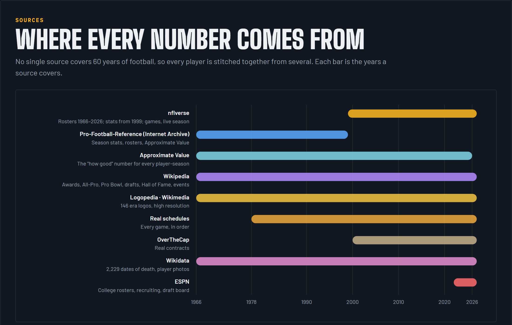

# Sources

No single source covers 60 years of the NFL, so every player is matched across several.

| Source | Covers | Used for |
|---|---|---|
| [nflverse](https://github.com/nflverse) | 1966–2027 rosters, 1999+ stats, games, weekly injuries | The backbone: player IDs, birthdates, heights, weights, modern stats, the live season |
| Pro-Football-Reference (via the Internet Archive) | 1966–98 season, roster, team and draft pages | Pre-1999 stats, Approximate Value for every season |
| Wikipedia | Awards, All-Pro and Pro Bowl teams, drafts, Hall of Fame, retired numbers, uniform histories | Honors, drafts, jersey eras, events and their reasons |
| Logopedia, Wikimedia Commons | Primary logos | Era looks, rebuilt at high resolution from vector originals where they exist |
| SportsLogos.net | Logo dates, secondary logos | Dated primary and alternate logos for every franchise, used to audit primaries and to choose secondaries |
| Wikipedia | Logo overrides | Used over SportsLogos where it is explicit and cited (Bears, Giants, Jets, Patriots) |
| Wikidata | Deaths, photos | 2,229 dates of death and 4,700 player photos |
| ESPN | College football | Rosters, recruiting grades, the 2027 draft board and headshots for the draft classes |
| spreadspoke, nflverse games | Scores and schedules 1966+ | Team results and real schedules |
| OverTheCap | Contracts 2000+ | Real salaries; earlier ones are estimates scaled to each era |
| Madden | 2001+ | Cross-checks for the ratings, not their source |

## Why the Internet Archive

Pro-Football-Reference is the best record of pre-1999 football, but scraping the live site is rate limited and against its terms. Archived snapshots of the same pages are public, so the 1966–98 pages were read from those (`fetch_pfr_wayback.js`, `pfr_wayback_stats.js`).

## Why Approximate Value

Football has no single stat that works across positions the way win shares do in basketball. PFR's Approximate Value (AV) is the closest: one number per player season, for every position, all the way back. It decides how *good* a player is rated; his own stats decide what *kind* of player he is. See [ratings.md](ratings.md).

## Known gaps

- Tackles weren't tracked league-wide before 1994, or forced fumbles and passes defended before 1999. Sacks are unofficial before 1982.
- About 15 team eras use the current logo because no historical image could be found.
- Football GM shows its small logo on most screens, so league files use the primary there. Secondary logos are kept in the logo data for places that can show them. Where a season has several alternates, the longest-running one is kept, and wordmarks are not counted. The Panthers' 1995-2011 alternate is left out because it exists only on a white background.
- About half the secondaries come from small source files (under 256 pixels), because no full-size file was available.
- Bears, 1962-2022: SportsLogos lists bears as primary for 1955-88, while Wikipedia lists the C from 1962. The project keeps the C.
